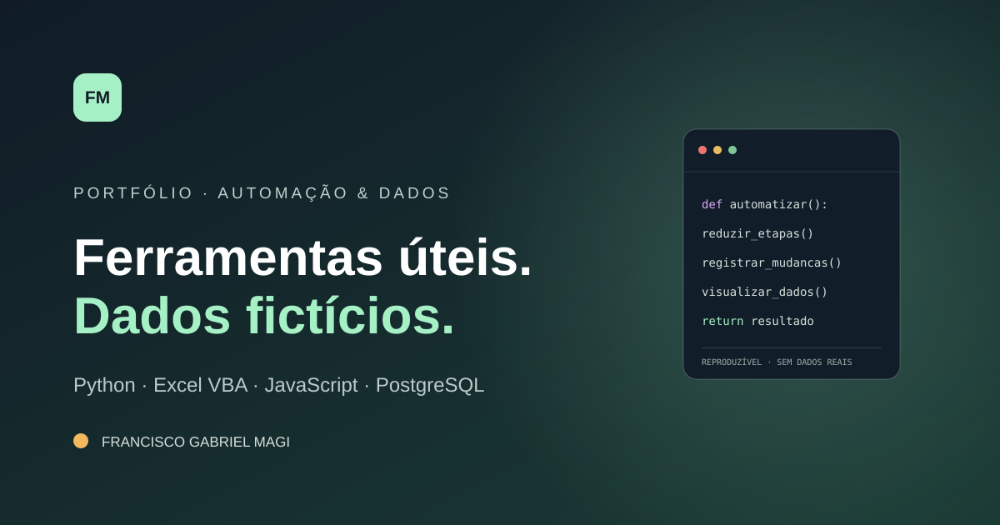

# Portfólio de Automação e Dados

Portfólio técnico de Francisco Gabriel Magi com protótipos pequenos, executáveis e documentados em Python, Excel VBA, JavaScript e PostgreSQL.



> **Privacidade:** demonstrações recriadas para portfólio. Nenhum código, tela, arquivo, macro ou dado de empresa foi copiado. Todas as bases são fictícias.

## Veja o portfólio

A página `index.html` é o site estático do portfólio: apresenta os projetos, permite filtrar por tecnologia e funciona sem bibliotecas ou chamadas externas.

Para abrir localmente, na raiz do repositório execute:

```bash
python -m http.server 8000
```

Acesse `http://localhost:8000/`.

## Projetos em destaque

| Projeto | Stack | Demonstra |
|---|---|---|
| [Painel de Produção](projects/painel-producao/) | HTML, CSS, JavaScript | filtros, busca, indicadores derivados de CSV |
| [Monitor de Arquivos](projects/monitor-arquivos/) | Python 3.10+ | SHA-256, CLI, logging JSONL, modo contínuo |
| [Planejamento Semanal](projects/planejamento-vba/) | Excel VBA | filtrar dados, gerar aba de saída e ordenar por prazo |
| [Consultas SQL](projects/consultas-sql/) | PostgreSQL 14+ | agregações, CTE, `FILTER`, `LAG` e funções de janela |

Cada pasta tem um README com requisitos, execução, estrutura e limitações.

## Publicar no GitHub

1. Crie no GitHub um repositório vazio chamado `portfolio-automacao-dados` (sem gerar outro README ou licença).
2. No terminal, nesta pasta, conecte o remoto e envie a branch `main`:

```bash
git remote add origin https://github.com/SEU-USUARIO/portfolio-automacao-dados.git
git push -u origin main
```

Troque `SEU-USUARIO` pelo seu nome de usuário do GitHub. Antes de criar novos commits, configure o nome e o e-mail público `noreply` recomendado pelo GitHub para não usar um e-mail do trabalho.

## Publicar o site como GitHub Pages

Depois do push, abra **Settings → Pages**, selecione **Deploy from a branch**, a branch `main` e a pasta `/ (root)`. O site usa apenas arquivos estáticos desta raiz; não precisa de build ou instalação de dependências.

## Privacidade e escopo

- Dados de demonstração inventados, marcados com identificadores `DEMO`.
- Sem serviços externos, chaves, tokens ou endereços internos.
- O painel analítico é uma demonstração web, não um arquivo Power BI `.pbix`.
- A macro VBA e o monitor Python são recriações didáticas e independentes.

## Licença

MIT. Veja [LICENSE](LICENSE).


