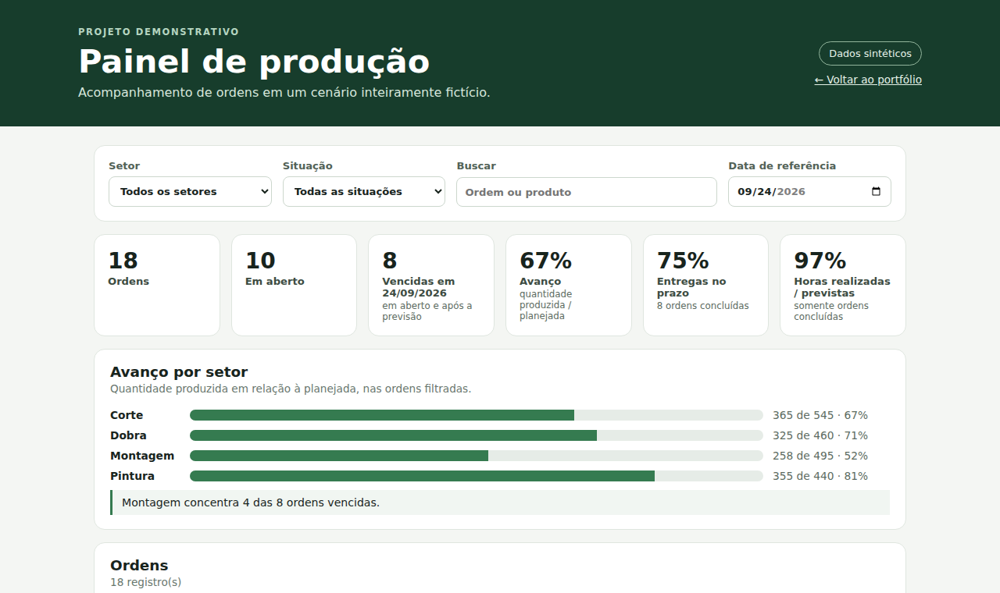

# Francisco Gabriel Magi · Automação e dados

[](https://github.com/SEU-USUARIO/portfolio-automacao-dados/actions/workflows/ci.yml)
[](LICENSE)

Quatro projetos pequenos, executáveis e com testes automatizados, em JavaScript, SQL, Python e Excel VBA. Todos usam **dados fictícios**; nenhum arquivo, tela ou código de empresa está aqui.

**[Ver o site do portfólio](https://SEU-USUARIO.github.io/portfolio-automacao-dados/)** · **[Abrir o painel interativo](https://SEU-USUARIO.github.io/portfolio-automacao-dados/projects/painel-producao/)**



## Projetos

| Projeto | O que demonstra | Ferramentas | Ver |
| --- | --- | --- | --- |
| Painel de produção | Indicadores, filtros, gráfico e tabela ordenável a partir de um CSV; lógica separada da interface e testada | HTML, CSS, JavaScript | [Demo](https://SEU-USUARIO.github.io/portfolio-automacao-dados/projects/painel-producao/) · [README](projects/painel-producao/README.md) |
| Consultas de produção | Tabela de fatos, agregações, CTE, funções de janela e `FILTER`; resultados conferidos em PostgreSQL 16 | PostgreSQL | [SQL](projects/consultas-sql/consultas.sql) · [Resultados](projects/consultas-sql/resultados.md) · [README](projects/consultas-sql/README.md) |
| Monitor de arquivos | CLI que detecta alterações por SHA-256, com log sem conteúdo do arquivo, tratamento de erros e testes unitários | Python | [Código](projects/monitor-arquivos/monitor.py) · [README](projects/monitor-arquivos/README.md) |
| Planejamento semanal | Macro que leva itens em aberto para uma aba de planejamento e ordena por prazo | Excel VBA | [Módulo](projects/planejamento-vba/AtualizarPlanejamento.bas) · [README](projects/planejamento-vba/README.md) |

## Os dados

[`data/ordens_producao.csv`](data/ordens_producao.csv) (18 ordens fictícias) é a fonte única do painel e das consultas SQL, então os números coincidem nas duas ferramentas: por exemplo, o setor Corte tem 67% de avanço no painel e na consulta 1. O monitor e a macro usam amostras próprias, pequenas, na pasta de cada projeto.

## Executar localmente

Na raiz do repositório:

```bash
python -m http.server 8000
```

Abra `http://localhost:8000/` para o site e `http://localhost:8000/projects/painel-producao/` para o painel. Cada projeto tem seu README com requisitos e passos.

## Testes

O workflow de [CI](.github/workflows/ci.yml) roda a cada push. Para rodar localmente:

```bash
python -m unittest discover -s projects/monitor-arquivos -v   # Python 3.10+
node --test projects/painel-producao/metrics.test.js          # Node 18+
```

As consultas SQL são executadas em um PostgreSQL 16 no CI (esquema, carga do CSV e as dez consultas).

## Limites conhecidos

- O painel é uma demonstração web, não um `.pbix`; as medidas DAX em [`docs/medidas.dax`](projects/painel-producao/docs/medidas.dax) servem de referência para reconstruir o modelo no Power BI Desktop.
- A macro VBA precisa de Excel desktop e roda sobre a tabela `tbOrdens`.
- O monitor acompanha um arquivo por vez e grava o log apenas localmente.

## Licença

MIT. Consulte [LICENSE](LICENSE). O visual da homepage é inspirado em sites pessoais do fim dos anos 1990; as referências estão em [docs/referencia-web-pessoal-anos-90.md](docs/referencia-web-pessoal-anos-90.md).
