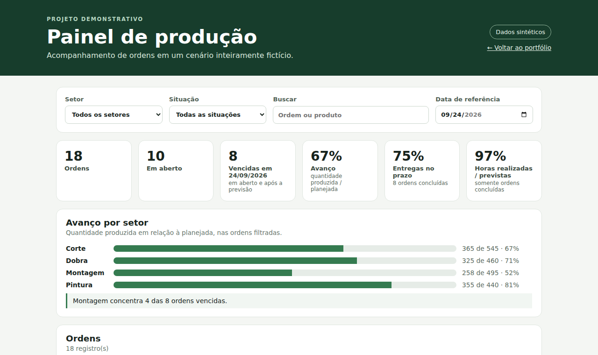

# Painel de produção



Página estática que lê [`data/ordens_producao.csv`](../../data/ordens_producao.csv), calcula os indicadores no navegador e permite explorar as ordens. Sem bibliotecas externas, sem etapa de build e sem backend.

## O que mostra

- Seis indicadores: ordens, em aberto, vencidas, avanço, entregas no prazo e horas realizadas/previstas.
- Gráfico de barras (CSS puro) com o avanço por setor e uma frase de destaque calculada, por exemplo onde as ordens vencidas se concentram.
- Filtros por setor e situação, busca por ordem ou produto e **data de referência** editável.
- Tabela ordenável por qualquer coluna, com as ordens vencidas sinalizadas.
- Mensagens claras quando o CSV não carrega ou quando a página é aberta direto do disco.

## Executar

Na **raiz do repositório**:

```bash
python -m http.server 8000
```

Acesse `http://localhost:8000/projects/painel-producao/`. Um servidor local é necessário porque o navegador bloqueia `fetch` e módulos ES em arquivos abertos via `file://`.

## Decisões

- **Data de referência fixa (24/09/2026).** A amostra é de setembro de 2026; usar a data de hoje marcaria todas as ordens abertas como vencidas. 24/09 é o dia seguinte à última conclusão registrada. A data pode ser alterada na própria página, e as consultas SQL e as medidas DAX usam o mesmo valor.
- **Pontualidade e horas só consideram ordens concluídas.** Comparar as horas parciais de uma ordem em andamento com o planejado inteiro faria a utilização parecer baixa demais.
- **Lógica separada da interface.** [`metrics.js`](metrics.js) não toca no DOM e é testado com `node --test`; [`app.js`](app.js) só monta a tela.
- **Sem `innerHTML` com dados.** Os elementos são criados com `textContent`, então um valor malicioso no CSV não vira HTML.
- **Leitor de CSV próprio** com suporte a aspas e a finais de linha LF/CRLF, coberto por teste.

## Testes

```bash
cd projects/painel-producao
node --test metrics.test.js   # Node 18+
```

Os testes conferem, entre outros, que os indicadores e o avanço por setor coincidem com a saída das consultas SQL do repositório.

## Arquivos

- `index.html`, `styles.css`, `app.js`: página, estilo e interface.
- `metrics.js`, `metrics.test.js`: cálculos e testes.
- `docs/medidas.dax`: medidas equivalentes, como referência para o Power BI.
- `docs/modelo.svg`: esquema conceitual.
- `docs/painel.png`: captura de tela usada neste README.

## Power BI

Este exemplo não inclui `.pbix`. O CSV, o esquema conceitual e as medidas servem para reconstruir o modelo no Power BI Desktop.
